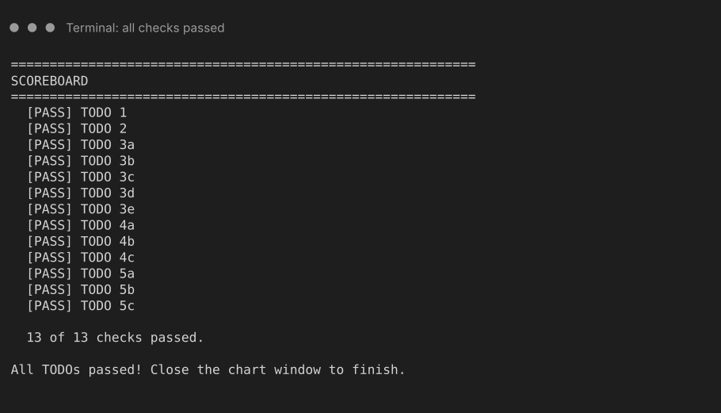

# Streaming History Cleanup

Clean up a messy export of music listening history, pick out the rows you care about, and draw a chart, using Python's two most popular data tools: **NumPy** and **pandas**. Along the way you will learn why raw data is almost never ready to use, and how a few short lines of code can fix it.


## At a glance

| | |
|---|---|
| **Schedule topic** | Section 1: Murach's Python for Data Science, essential concepts and skills (NumPy, pandas, DataFrames, data cleaning, filtering rows, basic plots) |
| **Textbook** | McCoy, S. *Murach's Python for Data Science* (2nd ed.), Section 1. **Chapter(s): [FILL IN]. Printed pages: [FILL IN].** |
| **Time** | About 15 to 20 minutes for TODOs 1 to 5, plus optional bonus challenges |
| **You will practice** | NumPy arrays, loading a CSV into a DataFrame, cleaning text/number/missing/duplicate problems, filtering rows with conditions, and a basic bar chart |
| **Python** | 3.10 or newer |
| **Packages** | `pandas`, `numpy`, `matplotlib` (see [Setup](#setup)) |

## Why this is worth learning

Real data is messy. One app writes the genre as `Pop`, another as `pop `, a song length arrives as the text `3.4 min`, a play count is missing, and the same listen gets saved twice. If you analyze that data as it is, your totals and charts will be **wrong without any error message telling you so**.

This is the everyday work of a data analyst. The same steps (load, inspect, clean, filter, plot) show up in:

- **Apps you already use:** "year in review" style summaries from streaming services are built by turning long tables of listening history into counts and charts.
- **Business reports:** sales dashboards in Power BI or Tableau start from cleaned tables like this one.
- **Spreadsheets:** Excel's *Remove Duplicates*, *Trim*, and *Filter* buttons do the same jobs. With pandas you write them once and rerun them on next month's file.

## Three key ideas

1. **A DataFrame is a table, and a column is a NumPy array wearing a label.** NumPy lets you do math on a *whole array at once* (`minutes * plays`) with no loop. pandas columns work the same way, which is why `df["minutes"] * df["plays"]` makes a whole new column in one line. *(Book: [FILL IN pages])*

2. **Cleaning means fixing the data before you trust it, and pandas methods give you back a new result.** The usual problems are duplicate rows, inconsistent text, numbers stored as text, and missing values. Methods like `.str.strip()` or `.fillna()` do not change your DataFrame by themselves. You have to **assign the result back**. *(Book: [FILL IN pages])*

3. **Filtering uses True/False masks.** A comparison like `df["total_minutes"] >= 10` makes a column of True/False values, one per row. Putting that inside `df[ ... ]` keeps only the True rows. To combine conditions you use `&` (and) and `|` (or), with each condition in parentheses. *(Book: [FILL IN pages])*

The payoff is the plot: once the data is clean, one call like `.plot(kind="bar")` turns a column into a chart (pandas hands the drawing to matplotlib).

## Before you start

You need Python 3.10 or newer and VS Code (or any editor plus a terminal).

Check your Python version. In a terminal, run:

| Windows | Mac |
|---|---|
| `python --version` | `python3 --version` |

## Setup

1. **Clone the repository.** Open a terminal in the folder where you keep class work, then run (replace the placeholder with the real link):

   ```
   git clone https://github.com/<your-username>/music-history-cleanup.git
   ```

   No Git? On the repository page click **Code > Download ZIP** and unzip it instead.

2. In VS Code choose **File > Open Folder** and open the `music-history-cleanup` folder.

3. Open a terminal with **Terminal > New Terminal**. It should already be inside `music-history-cleanup`.

4. **Install the packages** (one time only):

   | Windows | Mac |
   |---|---|
   | `python -m pip install -r requirements.txt` | `python3 -m pip install -r requirements.txt` |

5. Open `code/music_cleanup_starter.py`. **This is the only file you will edit.**

**Run command** (use it after every TODO):

| Windows | Mac |
|---|---|
| `python code/music_cleanup_starter.py` | `python3 code/music_cleanup_starter.py` |

> **Stuck?** The finished program is in `code/music_cleanup_finished.py`. It is the starter with TODOs 1 to 5 filled in, line for line. Try each step yourself first, then use it to compare.

## How the starter file works

The starter is a normal Python script that runs from top to bottom. After each TODO there is a **check**:

- `[PASS]` means your code worked and the program keeps going.
- `[TODO]` means that step is not finished yet. You get a hint, and the program stops there so you always know exactly where you are.

Run the starter **before changing anything**. You should see this (the checks are all empty):

```
STREAMING HISTORY CLEANUP LAB
=== STEP 1: NumPy warm-up ===
  [TODO] TODO 1 is not finished yet.
         Hint: ...
SCOREBOARD
  [    ] TODO 1  ...
  0 of 13 checks passed.
```

The data lives in `code/data/music_history_messy.csv`: 50 rows, 9 columns (`listen_id, date, artist, genre, track, minutes, plays, device, rating`). One row is one listening session: a track, how long it is, and how many times it was played that day. It is made-up data (the artists and tracks are fictional), with problems added on purpose.

## The activity

TODOs 1 to 5 are the activity. TODOs 6 and 7 are bonus challenges. Each TODO ends with a **Checkpoint** that tells you what you should see.

### TODO 1: NumPy warm-up

Find STEP 1 in the starter. Two NumPy arrays are already made: `minutes` (song lengths) and `plays` (how many times each was played). Replace the three `None` values:

- `minutes_listened`: each song's length times its plays (multiply the two arrays with `*`)
- `total_minutes`: the sum of `minutes_listened` (`.sum()`)
- `average_length`: the average of `minutes` (`.mean()`)

**Checkpoint 1:** `[PASS] TODO 1`, then `Minutes listened per song: [7.  4.  7.5 6. ]`, `Total listening time     : 24.5 minutes`, and `Average song length      : 3.25 minutes`. Notice you wrote **no loop**.


### TODO 2: Load the data into a DataFrame

Replace `listens = None` with code that reads the CSV file. `DATA_FILE` already holds the file path. You need `pd.read_csv(...)`.

**Checkpoint 2:** `[PASS] TODO 2`, shape `(50, 9)`, and a diagnosis report. Read it carefully and answer: **what is wrong with this data?** You should spot four problems:

- 5 duplicate rows
- 4 missing play counts (and 5 missing ratings)
- the `minutes` column is text because some values end in `min`
- 13 different spellings for only 5 genres

> Your `info()` output may say `object` where mine says `str`. That depends on your pandas version and is fine.


### TODO 3: Clean the data (five small steps)

We work on a copy called `clean`, so `listens` stays untouched. Each step below has a `# your code here` line. Every step needs `clean[...] = ...` or `clean = ...`, because **the result must be assigned back** (see [Common mistakes](#common-mistakes)).

| Step | Problem | Tools to use |
|---|---|---|
| **3a** | Duplicate rows | `.drop_duplicates()` then `.reset_index(drop=True)` |
| **3b** | `"pop"`, `" Pop"`, `"POP "` | `.str.strip()` and `.str.title()` on the genre column |
| **3c** | Minutes are text like `"3.4 min"` | `.str.replace(" min", "", regex=False)` then `.astype(float)` |
| **3d** | Missing play counts | `.fillna(1)` then `.astype(int)` |
| **3e** | Need total listening time for each row | Multiply two columns into a new column named `total_minutes` |

Why `fillna(1)`? A listen with no play count was most likely played once. That is a choice we made, not a rule: another analyst might drop those rows instead.

**Checkpoint 3:** five `[PASS]` lines, then shape `(45, 10)`, the genres `['Electronic', 'Hip-Hop', 'Lo-Fi', 'Pop', 'Rock']`, minutes type `float64`, and `Total listening time: 354.2 minutes`.


### TODO 4: Filter rows

Use the True/False mask idea (key idea 3). Fill in the three `None` values:

- **4a** `pop_listens`: only the rows where the genre is `"Pop"` (use `==`, two equal signs)
- **4b** `long_listens`: only the rows where `total_minutes` is 10 or more
- **4c** `long_phone_listens`: rows where the device is `"Phone"` **and** `total_minutes` is 10 or more. Use `&` and put each condition in its own parentheses.

**Checkpoint 4:** `Pop listens: 12`, `Long listens (10+ minutes): 16`, `Long listens on a Phone: 7`, and a small table of those 7 listens.


### TODO 5: Make a plot

Fill in three things:

- **5a** `genre_counts`: how many listens each genre has (a column has a `.value_counts()` method)
- **5b** draw `genre_counts` as a bar chart on `ax`: `genre_counts.plot(kind=..., ax=ax, color=...)`
- **5c** give the chart a title and axis labels with `ax.set_title(...)`, `ax.set_xlabel(...)`, `ax.set_ylabel(...)`

**Checkpoint 5:** all 13 checks pass on the scoreboard, a chart window opens, and a picture is saved to `code/output/listens_per_genre.png`. Pop is the tallest bar with 12 listens, and Electronic is the shortest with 6. Close the chart window to finish the program.




> No chart window (for example on a remote computer)? Set `SHOW_PLOT = False` near the top of the file. The chart is still saved to `code/output/`.

## Bonus challenges (on your own)

Finished early, or want to keep going after class? Write these in the **BONUS AREA** near the bottom of the starter file. They are not checked by the program.

### TODO 6 (bonus): Listening time by genre

Which genre did you spend the most *time* on? Counting listens (TODO 5) is not the same as adding up minutes.

1. Group the rows by genre, then add up `total_minutes` for each group: `clean.groupby("genre")["total_minutes"].sum()`
2. Add `.sort_values()` on the end so the bars are in order.
3. Draw it as a horizontal bar chart (`kind="barh"`) with a title.

**Checkpoint 6:** Pop has the most listening time (`95.0`) and Lo-Fi the least (`31.3`). Now compare with TODO 5: Electronic has *fewer listens* than Lo-Fi (6 vs 8) but *more minutes* (`56.0` vs `31.3`). Why? (Hint: look at how long the songs are.)

<details>
<summary>Example answer (try it yourself first)</summary>

```python
minutes_by_genre = clean.groupby("genre")["total_minutes"].sum().sort_values()
fig2, ax2 = plt.subplots(figsize=(7, 4))
minutes_by_genre.plot(kind="barh", ax=ax2, color="teal")
ax2.set_title("Listening time by genre")
ax2.set_xlabel("Total minutes")
ax2.set_ylabel("Genre")
plt.tight_layout()
print(minutes_by_genre)
```

</details>

### TODO 7 (bonus): Top 5 longest listens, then save your clean data

1. Sort the DataFrame by `total_minutes`, biggest first, and keep 5 rows: `.sort_values("total_minutes", ascending=False).head(5)`
2. Print just the columns `listen_id`, `artist`, `track`, `total_minutes`.
3. Save the whole clean DataFrame to `code/output/music_history_clean.csv` with `.to_csv(..., index=False)`. Put `.round(2)` before `.to_csv` to tidy tiny leftovers like `9.899999999999999`.

**Checkpoint 7:** the top listen is `2017`, *Signal Fade* by Neon Atlas, with `19.2` minutes. A new file `music_history_clean.csv` appears in `code/output/`. Open it: the minutes are plain numbers with no `min`. (If two rows tie for places 2 and 3, they may appear in either order.)

<details>
<summary>Example answer (try it yourself first)</summary>

```python
top5 = clean.sort_values("total_minutes", ascending=False).head(5)
print(top5[["listen_id", "artist", "track", "total_minutes"]])
clean.round(2).to_csv(OUTPUT_DIR / "music_history_clean.csv", index=False)
```

</details>

## Common mistakes

**Mistake 1 (cleaning): forgetting to assign.** Cleaning methods return a *new* column. They do not change the old one.

```python
clean["genre"].str.strip().str.title()                     # wrong: result thrown away
clean["genre"] = clean["genre"].str.strip().str.title()    # right: assigned back
```

With the first line, the program runs with no error, but the genre names stay messy. TODO 3b's check will catch this.

**Mistake 2 (filtering): using `and`.** In pandas, conditions are combined with `&` and `|`, and each condition needs its own parentheses.

```python
clean[(clean["device"] == "Phone") and (clean["total_minutes"] >= 10)]   # wrong
clean[(clean["device"] == "Phone") & (clean["total_minutes"] >= 10)]     # right
```

With `and`, Python cannot decide what to do with a whole column of True/False values and stops with `ValueError: The truth value of a Series is ambiguous.` Without the parentheses you get a confusing `TypeError` instead.

## Check your understanding

Try to answer before opening each one.

<details>
<summary>1. You ran the chart code but it shows "Pop", "pop", and "POP" as three separate bars. What went wrong?</summary>

The genre names were not cleaned (or the cleaned result was not assigned back). pandas treats `"Pop"` and `"pop"` as different text, so it counts them separately. Cleaning has to come before counting.

</details>

<details>
<summary>2. Why does <code>minutes * plays</code> work with no loop?</summary>

NumPy arrays do math on every pair of items at once (this is called vectorized math). pandas columns are built on NumPy, so `df["minutes"] * df["plays"]` works the same way.

</details>

<details>
<summary>3. What does <code>clean["total_minutes"] &gt;= 10</code> return by itself, before it goes inside <code>clean[ ]</code>?</summary>

A column of True/False values, one per row. Putting it inside `clean[ ]` keeps only the rows that are True.

</details>

<details>
<summary>4. In the loaded <code>listens</code> table, <code>listens["rating"].mean()</code> is calculated from 45 numbers, not 50, even though no rows were removed. Why?</summary>

The 5 missing ratings are `NaN` ("not a number"), and pandas skips `NaN` when it calculates a mean. Whether that is the right choice is a decision the analyst has to make.

</details>

## Connections

- **In class:** the same load, inspect, clean, filter, plot loop is the first half of every data analysis project in the textbook's later sections.
- **Homework:** [FILL IN: name the weekly homework or exercise that uses these skills, if there is one].
- **Real application:** try your own data. Many music, video, and fitness apps let you download your own history as a CSV or similar file. Load yours with `pd.read_csv` and see what is messy about it. (Check the app's own help pages for how to request your data.)

## Reflection

Take one minute and answer:

1. Which cleaning step would have caused the **biggest mistake** if we had skipped it? (Think: what would the total listening time or the chart have looked like?)
2. Where have you seen the "load, clean, filter, plot" pattern in an app or spreadsheet you already use?

## Troubleshooting

| What you see | What to try |
|---|---|
| `ModuleNotFoundError: No module named 'pandas'` | Run the install command in [Setup](#setup) step 4. Make sure VS Code is using the same Python (bottom-right corner of the window). |
| `python is not recognized` (Windows) | Try `py code/music_cleanup_starter.py` and `py -m pip install -r requirements.txt`. |
| `python: command not found` (Mac) | Use `python3` instead of `python`. |
| `FileNotFoundError` for the CSV | Run the command from inside the `music-history-cleanup` folder, with the folder opened in VS Code. |
| The program stops with `[TODO]` | That is the check telling you the step is not finished. Read the hint and the `# Hint:` comment above your code. |
| `NameError: name 'clean' is not defined` | Check your spelling. `clean` and `cleaned` are different names. |
| `AttributeError: Can only use .str accessor with string values` | You ran TODO 3c on a column that is already numbers. Re-run the program from the top (it reloads the data every time). |
| The plot window never appears | Set `SHOW_PLOT = False` and open `code/output/listens_per_genre.png` instead. |
| My output looks a little different (`object` vs `str`, `pandas.core.frame.DataFrame` vs `pandas.DataFrame`) | These come from different pandas versions. The numbers and results are the same. |
| `IndentationError` | Lines inside the same block must line up (4 spaces). |

## Project structure

```
music-history-cleanup/
|-- README.md                       this guide
|-- requirements.txt                packages to install
|-- .gitignore
|-- code/
|   |-- music_cleanup_starter.py    the file you edit
|   |-- music_cleanup_finished.py   finished TODOs 1 to 5, for comparing
|   `-- data/
|       `-- music_history_messy.csv the messy sample data (50 rows)
`-- docs/
    |-- facilitator_notes.md        presenter run-of-show
    |-- peer_test_log.md            checklist and results from peer testing
    `-- images/                     expected-output screenshots
```

## Known limitations

- The data is **made up** for this activity. The artists and tracks are fictional, and the problems in it were added on purpose and are tidier than most real data.
- The finished file covers TODOs 1 to 5. The bonus TODOs have no answer file; this README shows an example answer for each.
- The checks test *results*, not *style*. If your code gets the right result in a different way, it still passes.
- Only the genre column is cleaned for text problems. Real exports would also have messy artist and track names.
- The dataset has only 5 genres, so the charts are small. Real data would have far more categories.
- Screenshots of terminal output were drawn from the program's real output, not captured from a VS Code window, so colors and fonts on your screen will look different.
- I tested with Python 3.12 and pandas 3.0.6. The code uses only basic pandas features that also exist in pandas 2.x, but I have not tested older versions.

## Sources and AI use

- **Textbook:** McCoy, S. (2024). *Murach's Python for Data Science* (2nd ed.). Mike Murach & Associates. Section 1, Chapter(s) [FILL IN], pages [FILL IN].
- **Course materials:** the structure and README style follow the course's *Book Topic Teaching Activity* instructions and the LED Color Mixer example README.
- **Documentation:** pandas and NumPy official documentation were used to check method names and behavior.
- **Data:** `music_history_messy.csv` is synthetic data generated for this activity. The artists and tracks are fictional and not real recordings.
- **AI assistance:** I used Claude (Anthropic) to brainstorm the activity idea, draft the starter file, the finished file, this README, and the facilitator notes, and to generate the sample data and screenshots. **[EDIT THIS: describe what you personally did to verify, for example which pages of the book you compared against and the date you ran the starter from a clean start.]** Peer testing results and the changes I made afterward are in `docs/peer_test_log.md`.
