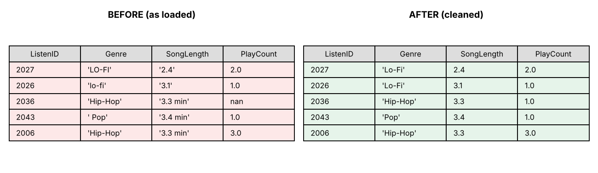
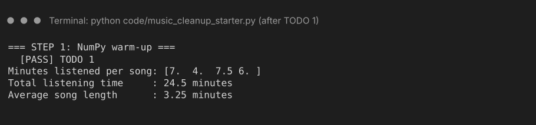
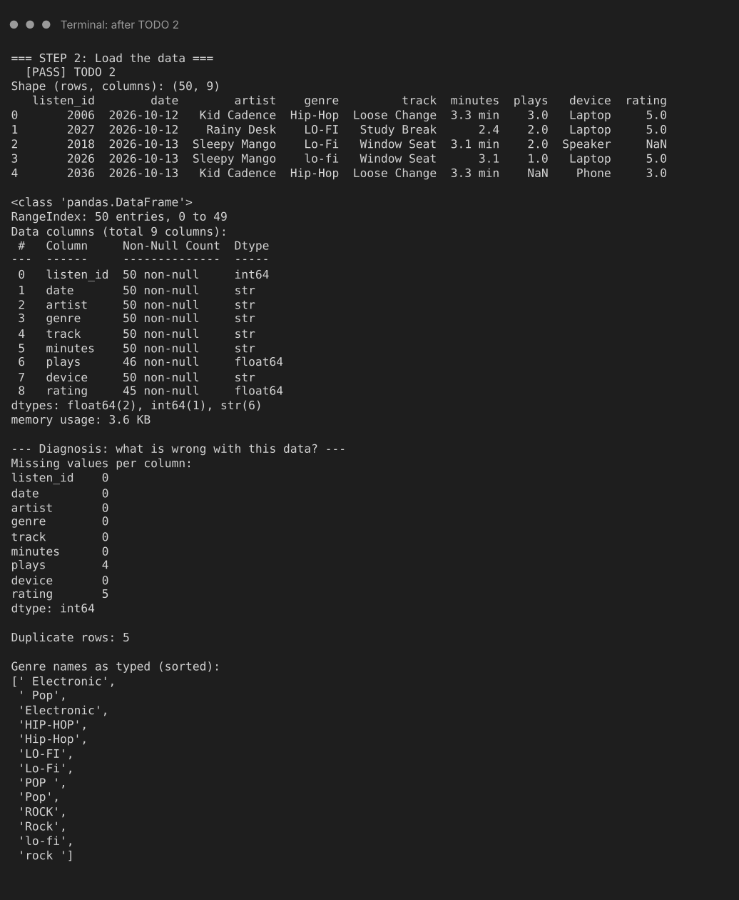
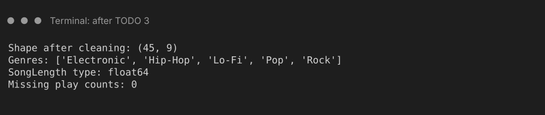
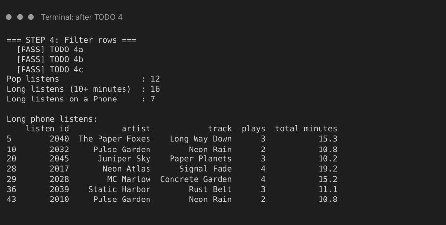
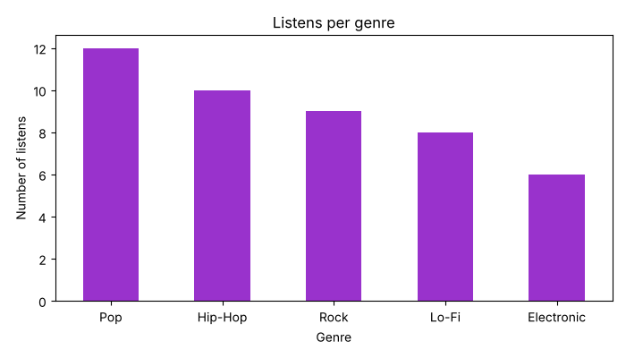
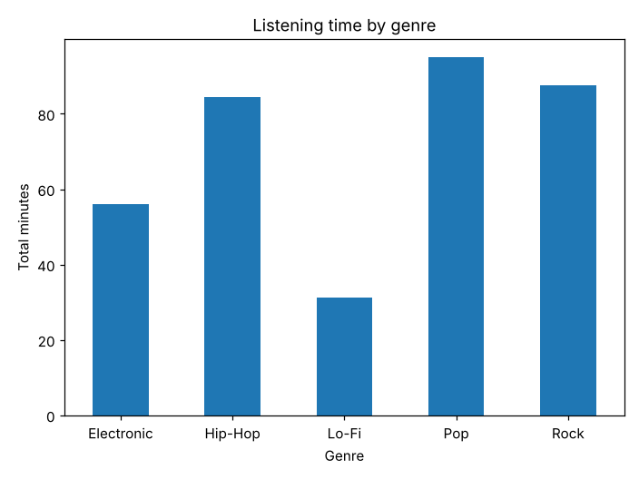

# Streaming History Cleanup

Clean up a messy export of music listening history, pick out the rows you care about, and draw a chart, using pandas. The guiding question:

> **How do we turn a table of raw data into an understandable result?**



## At a glance

| | |
|---|---|
| **Schedule topic** | Section 1: Murach's Python for Data Science, essential concepts and skills (NumPy, pandas, DataFrames, data cleaning, filtering rows, basic plots) |
| **Textbook** | McCoy, S. *Murach's Python for Data Science* (2nd ed.). **Chapter 2**, "The Pandas essentials for data analysis" (pp. 45-90) and **Chapter 3**, "The Pandas essentials for data visualization" (pp. 91-116) |
| **Time** | About 15 minutes for TODOs 1 to 5, plus optional bonus challenges |
| **What you write** | About a dozen short lines of code |
| **Python** | 3.10 or newer |
| **Packages** | `pandas`, `numpy`, `matplotlib` (see [Setup](#setup)) |

## Why this is worth learning

Real data is messy. One app writes the genre as `Pop`, another as `pop `, a song length arrives as the text `3.4 min`, a play count is missing, and the same listen gets saved twice. If you analyze that data as it is, your totals and charts will be **wrong without any error message telling you so**.

The same steps (load, inspect, clean, filter, summarize, plot) are the backbone of most data analysis, from a "year in review" summary in a music app to a business dashboard.

## The essential methods

This whole activity uses only these ten tools. If you remember nothing else, remember these:

| Step | Method | What it does | Book pages |
|---|---|---|---|
| Load | `pd.read_csv(path)` | Reads a CSV file into a DataFrame (a table) | Ch. 2, pp. 48-49 |
| Inspect | `.head()`, `.info()`, `.shape`, `.nunique()` | Shows what the data looks like before you touch it | Ch. 2, pp. 52-57 |
| Clean text | `.str.strip()`, `.str.title()`, `.str.replace()` | Fixes spaces, capital letters, and stray text | Ch. 2, pp. 54-55, 72-73 |
| Fix types | `.astype(float)` | Turns numbers-stored-as-text into real numbers | supplementary |
| Missing values | `.fillna(value)` | Fills gaps with a value you choose | supplementary |
| Duplicates | `.drop_duplicates()` | Removes repeated rows | supplementary |
| New column | `df["A"] * df["B"]` | Math on whole columns at once, no loop | Ch. 2, pp. 70-71 |
| Filter | `.query("...")` | Keeps only the rows that match a condition | Ch. 2, pp. 60-65 |
| Summarize | `.groupby("A")["B"].sum()` | One answer per category | Ch. 2, pp. 80-83 |
| Plot | `.plot.bar(title=, ylabel=)` | Turns a result into a chart | Ch. 2, pp. 84-85; Ch. 3, pp. 104-105, 110-113 |

**Supplementary** means the book pages I used do not teach it in detail, so I checked the pandas documentation instead. The NumPy warm-up (TODO 1) is also supplementary because the book has no NumPy section. It shows the same "math on a whole column" idea as the book's pp. 70-71.

## Three key ideas

1. **A DataFrame is the whole table, and a column is a Series.** Math on columns works on every row at once: `df["SongLength"] * df["PlayCount"]` needs no loop. *(Book: Ch. 2, pp. 46-47, 70-71.)*
2. **Inspect first, then clean, and cleaning methods give back a new result.** You have to **assign the result back** or nothing changes. *(Book: Ch. 2, pp. 52-57, 72-73.)*
3. **Filter, then group, then plot.** `query()` narrows the rows, `groupby()` summarizes them, and `.plot.bar()` draws the answer. *(Book: Ch. 2, pp. 60-65, 80-85; Ch. 3, pp. 104-113.)*

## Before you start

You need Python 3.10 or newer and VS Code (or any editor plus a terminal).

## Setup

1. **Clone the repository.** Open a terminal in the folder where you keep class work, then run (replace the placeholder with the real link):

   ```
   git clone https://github.com/charismalim12/music-history-cleanup.git
   ```

   No Git? On the repository page click **Code > Download ZIP** and unzip it instead.

2. In VS Code choose **File > Open Folder** and open the `music-history-cleanup` folder.

3. Open a terminal with **Terminal > New Terminal**. It should already be inside `music-history-cleanup`.

4. **Install the packages (do this once, or you will get `ModuleNotFoundError`):**

   | Windows | Mac |
   |---|---|
   | `python -m pip install -r requirements.txt` | `python3 -m pip install -r requirements.txt` |

   > **Mac: got an `externally-managed-environment` error?** Make a virtual environment instead:
   > `python3 -m venv .venv`, then `source .venv/bin/activate`, then `pip install -r requirements.txt`. After that, use `python` instead of `python3` in this terminal.

5. Open `code/music_cleanup_starter.py`. **This is the only file you will edit.**

**Run command** (use it after every TODO):

| Windows | Mac |
|---|---|
| `python code/music_cleanup_starter.py` | `python3 code/music_cleanup_starter.py` |

> **Stuck?** The finished program is in `code/music_cleanup_finished.py`. It is the starter with every TODO filled in. Try each step yourself first, then use it to compare.

## How the starter file works

It is a normal Python script that runs from top to bottom. It already has the `print` lines. **You only fill in the lines marked `TODO`.** Next to each `print` there is a comment like `# Expected: (50, 9)`. After each TODO, run the file and check that what you see matches what is expected. There are no automatic checks.

If you run it before finishing TODO 1, you will see an error with the word `NoneType`. That is normal: it means a TODO is still `None`.

The data is in `code/data/music_history_messy.csv`: 50 rows, 9 columns (`ListenID, Date, Artist, Genre, Track, SongLength, PlayCount, Device, Rating`). One row is one listening session. It is made-up data (the artists and tracks are fictional) with problems added on purpose.

## The activity

### TODO 1 (supplementary): NumPy warm-up

Two NumPy arrays are already made: `minutes` (song lengths) and `plays` (times each was played). Replace `None` with one line that multiplies them.

**Check:** `Minutes listened: [7.  4.  7.5 6. ]` and `Total: 24.5`. You wrote **no loop**. One multiplication did all four songs.



### TODO 2: Load and inspect

Replace `listens = None` with one line that reads the CSV file. `DATA_FILE` already holds the path.

**Check:** shape `(50, 9)`, plus the first five rows and the `info()` table. Then read the three diagnosis lines, because they tell you what is wrong with this data:

- **13** different genre spellings, but there are only 5 genres
- **4** missing play counts
- **5** duplicate rows

There is a fourth problem hiding in the `info()` table: `SongLength` is type `str` (text), not a number, because some values end in `min`.

> Your `info()` output may say `object` where mine says `str`. That depends on your pandas version and is fine.



### TODO 3: Clean the data (one fix per problem)

We work on a copy called `clean`, so `listens` stays untouched. The four lines already exist. **You add the fix to the end of each line**, using the `Hint:` next to it:

| Problem | What to add |
|---|---|
| Genre has `pop`, ` Pop`, `POP ` | `.str.strip()` then `.str.title()` |
| SongLength is text like `"3.4 min"` | `.str.replace(" min", "", regex=False)` then `.astype(float)` |
| PlayCount has gaps | `.fillna(1)` |
| Duplicate rows | `.drop_duplicates()` |

Why `fillna(1)`? A listen with no play count was most likely played once. That is a choice we made, not a rule: another analyst might drop those rows instead. These decisions should be justified, and missing values should not automatically become zero.

**Check:** shape `(45, 9)`, genres `['Electronic', 'Hip-Hop', 'Lo-Fi', 'Pop', 'Rock']`, `float64`, and `0` missing play counts. If you run the file before doing TODO 3, these lines show the *messy* values. That is how you can see the cleaning working.



### TODO 4: New column and filtering

Three lines to fill in:

- **4a** `TotalMinutes`: a new column made by multiplying `SongLength` by `PlayCount`. This is the same idea as TODO 1, but on DataFrame columns.
- **4b** `pop_listens`: only the Pop listens. Use `clean.query(...)`. `query()` takes a **string**, and text values go in quotes *inside* it, like `'Genre == "Pop"'`.
- **4c** `long_phone`: Phone listens that add up to 10 minutes or more. Join the two conditions with the word `and` inside the same query string.

**Check:** `Total listening time: 354.2`, `Pop listens: 12`, `Long phone listens: 7`, and a table of those 7 listens.



### TODO 5: Summarize and plot

- **5a** `genre_minutes`: group by `Genre`, pick the `TotalMinutes` column, and add them up with `.sum()`.
- **5b** draw `genre_minutes` as a bar chart with `.plot.bar(title=..., ylabel=...)`. Put the title and label inside the same call.

**Check:** the printout shows Pop with the most listening time (`95.0`) and Lo-Fi with the least (`31.3`), and a chart window opens. Close the chart window to finish the program.





> Chart window won't open? Your computer may not be able to show windows (for example, a remote computer). Add the line `plt.savefig("chart.png")` just above `plt.show()` and open the saved picture instead.

## Bonus challenges (on your own)

Write these at the bottom of the starter file. Both are optional.

### Bonus A: Count, total, and average per genre

Counting listens is not the same as adding up minutes. Use `.agg()` to get several answers at once (book pp. 80-83): group by genre, pick `TotalMinutes`, and call `.agg(["count", "sum", "mean"])`, then `.sort_values("sum")`.

**Check:** Lo-Fi has 8 listens and 31.3 minutes. Electronic has only 6 listens but 56.0 minutes. Why? (Hint: compare the `mean` column.)

<details>
<summary>Example answer (try it yourself first)</summary>

```python
summary = clean.groupby("Genre")["TotalMinutes"].agg(["count", "sum", "mean"])
print(summary.sort_values("sum").round(2))
```

Expected table (rounded):

| Genre | count | sum | mean |
|---|---|---|---|
| Lo-Fi | 8 | 31.3 | 3.91 |
| Electronic | 6 | 56.0 | 9.33 |
| Hip-Hop | 10 | 84.4 | 8.44 |
| Rock | 9 | 87.5 | 9.72 |
| Pop | 12 | 95.0 | 7.92 |

</details>

### Bonus B: Top 5 longest listens

Sort by `TotalMinutes`, biggest first, and keep 5 rows: `.sort_values("TotalMinutes", ascending=False).head(5)` (book pp. 66-67). Print only the columns `ListenID`, `Artist`, `Track`, `TotalMinutes` by putting a **list** of names inside the brackets: `df[["A", "B"]]`.

**Check:** the top listen is `2017`, *Signal Fade* by Neon Atlas, with `19.2` minutes. (Two rows tie for second place, so they may appear in either order.)

<details>
<summary>Example answer (try it yourself first)</summary>

```python
top5 = clean.sort_values("TotalMinutes", ascending=False).head(5)
print(top5[["ListenID", "Artist", "Track", "TotalMinutes"]])
```

</details>

## Common mistake: forgetting to assign the result back

Cleaning methods return a *new* column. They do not change the old one.

```python
clean["Genre"].str.strip().str.title()                     # wrong: result thrown away
clean["Genre"] = clean["Genre"].str.strip().str.title()    # right: assigned back
```

With the first line, the program runs with no error, but the genre names stay messy. The `Expected` comments are how you catch it: the genres list would still show 13 spellings.

**Related, inside `query()`:** text needs quotes. `clean.query("Genre == Pop")` fails with `UndefinedVariableError: name 'Pop' is not defined`. Write `clean.query('Genre == "Pop"')`.

## Check your understanding

Try to answer before opening each one.

<details>
<summary>1. You made the chart but it shows "Pop", "pop", and "POP" as three separate bars. What went wrong?</summary>

The genre names were not cleaned (or the cleaned result was not assigned back). pandas treats `"Pop"` and `"pop"` as different text, so it groups them separately. Cleaning has to come before grouping.

</details>

<details>
<summary>2. Why does <code>clean["SongLength"] * clean["PlayCount"]</code> work with no loop?</summary>

pandas (and NumPy) do math on every pair of values at once. This is called a vectorized calculation (book pp. 70-71).

</details>

<details>
<summary>3. If we skipped <code>.drop_duplicates()</code>, which number in this activity would be wrong, and in which direction?</summary>

The total listening time (and the chart) would be too high, because 5 listens would be counted twice. Nothing would crash, so you would not notice without checking.

</details>

## Connections

- **In class:** the same load, inspect, clean, filter, plot loop is the practical workflow Chapter 2 teaches, and Chapter 3 goes deeper into the plotting step.
- **Homework:** [FILL IN: name the weekly homework or exercise that uses these skills, if there is one].
- **Real application:** try your own data. Many music, video, and fitness apps let you download your own history as a CSV or similar file. Load yours with `pd.read_csv` and see what is messy about it. (Check the app's own help pages for how to request your data.)

## Reflection

Take one minute and answer:

1. Which cleaning step would have caused the **biggest mistake** if we had skipped it?
2. Where have you seen the "load, clean, filter, plot" pattern in an app or spreadsheet you already use?

## Troubleshooting

| What you see | What to try |
|---|---|
| `ModuleNotFoundError: No module named 'numpy'` (or `pandas`, `matplotlib`) | The packages are not installed. Run the install command in [Setup](#setup) step 4. On a Mac, if that fails, use the virtual environment note there. Make sure VS Code is using the same Python (bottom-right corner of the window). |
| `python is not recognized` (Windows) | Try `py code/music_cleanup_starter.py` and `py -m pip install -r requirements.txt`. |
| `python: command not found` (Mac) | Use `python3` instead of `python`. |
| `FileNotFoundError` for the CSV | Run the command from inside the `music-history-cleanup` folder, with the folder opened in VS Code. |
| `NoneType` in an error message | A TODO above that line is still `None`. Fill it in. |
| My printed numbers don't match `Expected` | Look at the TODO just above the first wrong number. Did you assign the result back? |
| `UndefinedVariableError: name 'Pop' is not defined` | Put quotes around the text inside the query string: `'Genre == "Pop"'`. |
| `AttributeError: Can only use .str accessor with string values` | The song length is already a number. Run the whole file again from the top (it reloads the data every time). |
| My output looks a little different (`object` vs `str`, `pandas.core.frame.DataFrame` vs `pandas.DataFrame`) | These come from different pandas versions. The numbers and results are the same. |
| `IndentationError` | Lines inside the same block must line up (4 spaces). |

## Project structure

```
music-history-cleanup/
|-- README.md                       this guide
|-- requirements.txt                packages to install
|-- .gitignore
|-- code/
|   |-- music_cleanup_starter.py    the file you edit
|   |-- music_cleanup_finished.py   every TODO filled in, for comparing
|   `-- data/
|       `-- music_history_messy.csv the messy sample data (50 rows)
`-- docs/
    |-- facilitator_notes.md        presenter run-of-show
    |-- peer_test_log.md            checklist and results from peer testing
    `-- images/                     expected-output screenshots
```

## Known limitations

- The data is **made up** for this activity. The artists and tracks are fictional, and the problems in it were added on purpose and are tidier than most real data.
- I kept the activity small on purpose. The book also covers column-name cleanup (pp. 54-55), the `.replace()` dictionary (pp. 72-73), `.loc[]` (pp. 62-65), reshaping with `pivot()` and `melt()` (pp. 74-79), and more plot types (Ch. 3). They are not part of this activity.
- The checks are done by you, by comparing with the `Expected` comments. The program does not grade you.
- The book pages I used do not teach NumPy, duplicates, or missing values in detail, so those steps are labeled **supplementary**.
- Only the Genre column has messy text. Real exports would also have messy artist and track names.
- Screenshots of terminal output were drawn from the program's real output, not captured from a VS Code window, so colors and fonts on your screen will look different.
- I tested with Python 3.12 and pandas 3.0.6. The code uses only basic pandas features that also exist in pandas 2.x, but I have not tested older versions.

## Sources and AI use

- **Textbook:** McCoy, S. (2024). *Murach's Python for Data Science* (2nd ed.). Mike Murach & Associates. Chapter 2, pp. 45-90, and Chapter 3, pp. 91-116.
- **Course materials:** the structure and README style follow the course's *Book Topic Teaching Activity* instructions and the LED Color Mixer example README.
- **Documentation:** pandas and NumPy official documentation were used to check method names and behavior of the supplementary steps.
- **Data:** `music_history_messy.csv` is synthetic data generated for this activity. The artists and tracks are fictional and not real recordings.
- **AI assistance:** I used ChatGPT to summarize photos of the textbook pages into study notes, and Claude (Anthropic) to brainstorm the activity idea, draft the starter file, the finished file, this README, and the facilitator notes, and to generate the sample data and screenshots. **[EDIT THIS: describe what you personally did to verify, for example which page numbers you compared against the physical book and the date you ran the starter from a clean start.]** Peer testing results and the changes I made afterward are in `docs/peer_test_log.md`.
